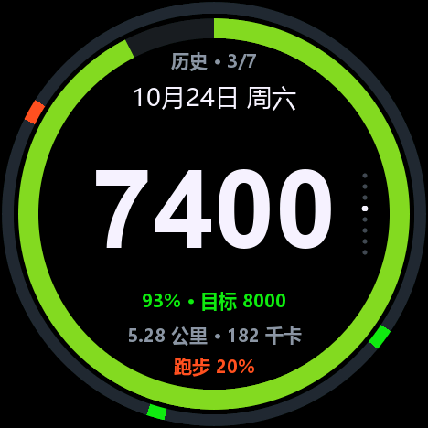

# StopWatch 计步器

M5Stack StopWatch（C152）的计步固件。步数由 BMI270 片上 feature engine 统计，MCU 不读取加速度数据，深睡期间继续计数。


## 硬件

ESP32-S3R8（16 MB Flash / 8 MB OPI PSRAM）、BMI270、466×466 CO5300 AMOLED、CST820 触摸、RX8130 RTC、M5PM1 电源管理、M5IOE1 IO 扩展、450 mAh 电池。

## 功能

- 主页：双色环（外圈 24 小时活动状态、内圈目标完成度）、时间日期、步数、距离与消耗、四段电量指示
- 今日详情：由主页上下滑动进入，含距离、消耗、活跃时长、步频、完成度
- 近 7 天柱状图，当日固定于最右格，未记录的日期留空；上下滑动逐日查看每日详情
- 每日详情与主页同为双色环：外圈是该日的 24 小时活动状态（跨天时把整天的 1440 格归档，可回看）
- 设置 10 项，列表滚动与手指位移同步，从设置入口点按进入
- 界面语言：简体中文 / English，切换后整屏文案立即生效
- 配色：主题色与强调色各用一个色轮选取，亮度单独调节
- 对时：日期三列滚轮与 24 小时表盘，结果写入 RX8130
- 息屏、深睡、震动与提示音
- 上下、左右翻页都有滑动过渡，旧页退出、新页进入

跑步与步行由 BMI270 的步态输出区分。外圈按当天时间顺序排布，静止、走路、跑步分别用轨道色、主题色、强调色标记；近 7 天柱体顶部按当日跑步占比着色，每日详情只报跑步占比。

## 页面

主页、近 7 天、设置入口三页参与左右循环。设置列表由入口页点按进入；对时页与配色页由设置列表进入。

| 主页 | 近 7 天 | 设置入口 | 设置列表 |
|---|---|---|---|
|  |  |  |  |

主页上滑进入今日详情，下滑返回。历史页上滑依次查看今天、昨天至六天前，再到下一页回到柱状图。每日详情与主页同为双色环，只有当天标「今天」，其余标「历史」：



凡是有上下滑动的页面（主页、近 7 天、设置列表）都在右侧中央竖排若干小圆点，指示当前位置；设置列表按屏计（10 项、一屏 5 项，共 2 屏）。

对时页左滑依次切换日期、时、分，点按确认并写入 RTC：


## 操作

屏幕为圆形，四角位于可视区外。页面内不设按钮，操作由手势与侧键完成。

| 手势 | 作用 |
|---|---|
| 左滑 / 右滑 | 切换页面；对时页进入下一层 / 返回上一层 |
| 点按 | 切换至下一页；设置入口进入设置列表；设置页修改数值；对时页写入 RTC |
| 上滑 / 下滑 | 主页进出今日详情；历史页逐日翻页 |
| 上下拖动 | 设置列表与日期轮随手指滚动，松开后吸附至整项 |

| 按键 | 关机时 | 亮屏时 | 息屏后 | 深睡中 |
|---|---|---|---|---|
| 黄键 | — | 短按翻到下一页；长按 1.2 s 回到主页 | 短按点亮屏幕；长按 1.2 s 点亮并回到主页 | 按下唤醒，重启后显示主页 |
| 蓝键 | — | 短按息屏 | 短按点亮屏幕 | 按下唤醒，重启后显示主页 |
| 黄键 + 蓝键 | — | 同时按住 10 s，清零当日成绩 | 同时按住 10 s，点亮屏幕并清零 | 按下唤醒，重启后继续按住 10 s 清零 |
| 电源键 | 单击开机；长按 2 s 进下载 | 双击关机；长按 2 s 进下载 | 单击无反应；长按 2 s 进下载 | 单击无反应；长按 2 s 进下载 |

## 设置项

| 项 | 范围 | 步进 | 默认 |
|---|---|---|---|
| 每日目标 | 1000–40000 步 | 500 | 8000 |
| 身高 | 120–220 cm | 1 | 172 |
| 体重 | 30–180 kg | 1 | 65 |
| 亮度 | 16–100% | 5% | 63% |
| 提示 | 静音 / 震动 / 震动+声音 | — | 震动+声音 |
| 息屏 | 5–120 s | 5 | 15 |
| 深睡 | 15–240 s | 15 | 45 |
| 对时 | 进入对时页 | — | — |
| 配色 | 进入色轮页 | 1° / 1% | 主题 165° 92% / 强调 12% 100% |
| 语言 | 简体中文 / English | — | 简体中文 |

列表每行右侧是一枚胶囊，胶囊左半为减、右半为加，按住 0.5 s 后连续变化。「对时」与「配色」行为入口，点按进入子页；「语言」行点按即切换。

配色页为色相环，环上拖动选取色相，中心圆内上下拖动调节亮度（30–100%），点按中心确认，左右滑动在主题色与强调色之间切换。主题色用于进度环、数值与选中态；强调色用于跑步段的着色。

设置存于 NVS 命名空间 `pedo2`，掉电保留。步幅按身高 × 0.415 计算，消耗按 0.53 kcal/(kg·km) 计算。

## 技术实现

| 项目 | 实现 |
|---|---|
| 显示 | M5GFX 驱动 CO5300，QSPI 80 MHz。466×466 RGB565 画布，双缓冲。横向切页由主循环统一做「旧帧滑出、新帧滑入」，竖向切子页由触摸侧用同一套画布滑动 |
| 双色环 | 外圈按 1 分钟一格记录当天活动，共 1440 格，按该分钟的步态取色，当前分钟涂到此刻；内圈为目标完成度。主页与每日详情用同一套几何 |
| 触摸 | CST820，I2C 轮询。按下后锁定主轴，纵向滚动列表，横向切换页面。改一格数值只重绘该行所在条带（整屏重绘约 140 ms，条带只要几十毫秒），震动在动画之前下发 |
| 计步 | BMI270 片上 feature engine 计数，配置包为 legacy（手机场景）。MCU 每秒读取一次计数器，累加差值；同一读出的步态字节区分步行与跑步 |
| 计时 | RX8130 RTC，I2C。每秒读取一次，用于显示与跨天判断 |
| 电源 | M5PM1 三路 LDO，M5IOE1 扩展 IO。显示屏与扬声器位于独立供电轨，可单独断开 |
| 存储 | 设置与当日成绩存于 NVS，含 1440 格分时明细（每格 2 bit，共 360 B）。跨天时把整天归档，另占 7 × 364 B，供每日详情回看。修改后 700 ms 写入 |
| 字体 | 点阵字模随固件编译 |

## 休眠与续航

息屏与深睡分两级：无操作 15 s（可调）后亮度归零，再经 45 s（可调）进入 deep sleep。

进入深睡前拉低 M5IOE1 的 IO8，断开显示屏所在的 L3B 轨，AMOLED 停止供电。BMI270 接于常电轨 L1，继续以 100 Hz 采样并计数。深睡期间每 60 s 定时唤醒一次，仅初始化 I2C 并读取计数器，约 25 ms 后继续休眠，显示屏保持关闭。

| 状态 | 电流 |
|---|---|
| 深睡（显示屏断电，BMI270 计数中） | 按 0.3–0.5 mA 计算 |
| 亮屏正常操作 | 按 60–80 mA 计算 |
| 屏幕全亮 | 约 154 mA |

以上均为估算，未做整机放电实测。深睡电流由各器件手册值分项相加得出，未计入常电轨上的 PMIC、IOE1 与漏电；亮屏电流按深色界面下的面板电流与主控、PSRAM、QSPI 刷屏开销相加得出。

有效容量按 450 mAh 标称值的 85% 计，即 380 mAh（放电截止 3.3 V，不含老化）：

| 每日亮屏 | 估算续航 |
|---|---|
| 10 分钟 | 15–20 天 |
| 30 分钟 | 8–10 天 |

接入 USB 时不进入深睡。

深睡期间每 5 分钟写入一次 NVS（步骤、活跃时长、日期），每日约 288 次。

## 刷入

发布包下载：[Releases](https://github.com/gpthimble/stopwatch-pedometer/releases/latest)。

完整镜像写入地址为 `0x0`；ESP32-S3 的 bootloader 位于 `0x0`，`0x1000` 为老款 ESP32 的偏移。仅升级 app 时写入 `0x10000`。

```bash
esptool --chip esp32s3 -p COM5 -b 460800 write_flash \
  --flash_mode keep --flash_freq keep --flash_size keep \
  0x0 dist/StopWatch_Pedometer_v2.5.bin
```

三个 `keep` 用于保留镜像 header 中的 flash 模式、频率与容量设定。省略时 header 被改写为 `qio`，ROM 停在 `mode:QIO` 之后反复复位。

进入下载模式：连接 USB，长按电源键约 2 s。网页烧写使用 <https://espressif.github.io/esp-launcher/>，地址 `0x0`、Size `16MB`、Mode `DIO`、Freq `80MHz`。烧写完成后双击电源键关机，再单击开机。

整片擦除将清除设置与步数记录。仅写入 `app_only` 至 `0x10000` 时保留。

## 编译

需要 arduino-cli、esp32 core 3.3.7 与 Python 3。

Windows 下双击 `build.bat`，或执行：

```bash
python tools/build.py
```

脚本获取 M5Unified 0.2.27 与 M5GFX 0.2.34 至 `tools/libs/`，应用 `docs/patches/0001-co5300-wakeup-timing.patch`，编译至 `out/`，输出固件大小与 SHA256。依赖已存在时跳过获取与打补丁。

编译前会核对字库：界面文案里的每个汉字都必须存在于 `ped_font.h`，缺字会直接报错并列出缺的字。字模由 `python tools/genfont.py` 从源码字符串字面量自动抓字生成，改动文案后先跑一遍（需要 Pillow 与系统里的微软雅黑）。

该补丁修正 CO5300 的唤醒时序（复位释放后等待 120 ms，SLPOUT 居首）；未应用时冷启动出现间歇性黑屏。

手动编译：

```bash
arduino-cli compile \
  --fqbn "esp32:esp32:esp32s3box:PartitionScheme=app3M_fat9M_16MB,DebugLevel=none" \
  --libraries tools/libs --output-dir out StopWatchPedometer
```

板卡为 `esp32s3box`；通用 `esp32s3` 使用 `qio_qspi` 内存类型，OPI PSRAM 无法启动。

编译路径写入镜像，不同目录下的构建产物大小与 SHA256 存在数十字节差异，功能不受影响。

## 串口命令

以 115200 波特率打开串口，发送单字符命令：

| 命令 | 作用 |
|---|---|
| `0`–`5` | 跳转至指定页面 |
| `d` | 历史子视图逐日翻页，走与触摸相同的过渡动画 |
| `n` / `p` | 下一页 / 上一页 |
| `c` | 打印计数与 IMU 状态 |
| `S` | 导出单帧 RGB565 |
| `I` | 导出 BMI270 寄存器与 feature 页 |
| `w` | 深睡诊断 |
| `k` | 对照内存设置与 NVS 实际值 |
| `B` | 当日步数清零 |
| `z` | 当日步数清零（保留跑步步数之外的字段） |
| `H` | 写入 6 天历史（含各日的分时轨迹），用于核对柱状图、逐日页与外环 |
| `A` | 按当前时刻回推一段活动轨迹，用于核对主页外环 |

`tools/devtool.py` 用于抓取屏幕画面：

```bash
python tools/devtool.py seq COM3 "3" page3.png
```

## 已知限制

- 手持晃动与骑行计入步数。
- 无 Wi-Fi 与 BLE，数据仅存于本机。
- 跨天清零依赖 RTC，RTC 未校准时不会自动清零。新日期需连续两次轮询读到才算跨天，时钟回拨只改锚点、不清成绩。
- 整片擦除会清除设置与记录；仅写 `app_only` 至 `0x10000` 时保留。
- 深睡唤醒需重建 QSPI 面板，自唤醒至可操作约 0.7 s。
- 计步每秒轮询一次，步频较高时显示值每次增加两级，累计数值不受影响。
- 息屏与深睡状态下触摸无效。
- 目标默认 8000 步；界面截图中该设置已改为 10000。

## 参考项目

| 项目 | 用途 |
|---|---|
| [boschsensortec/BMI270_SensorAPI](https://github.com/boschsensortec/BMI270_SensorAPI) | BMI270 配置包、feature 页地址、初始化流程 |
| [m5stack/M5Unified](https://github.com/m5stack/M5Unified) | 板级初始化、I2C |
| [m5stack/M5GFX](https://github.com/m5stack/M5GFX)（LovyanGFX） | 显示驱动与绘图，应用唤醒时序补丁 |
| [m5stack/M5StopWatch-UserDemo](https://github.com/m5stack/M5StopWatch-UserDemo) | M5PM1 / M5IOE1 / CO5300 的寄存器用法参考 |
| [m5stack/M5StopWatch-PowerDemo](https://github.com/m5stack/M5StopWatch-PowerDemo) | 电源分轨与深睡实测数据 |
| [espressif/arduino-esp32](https://github.com/espressif/arduino-esp32) | 3.3.7 核心 |
| [espressif/esptool](https://github.com/espressif/esptool) | 烧写与镜像合并 |

## 关于 AI 参与

本项目的固件代码、调试脚本与文档由 AI（WorkBuddy）编写，硬件实测、现象反馈与验收由项目作者完成。寄存器取值、配置包来源与页地址均对照上游源码与 Bosch 文档核对，关键结论在代码注释中标注出处。
