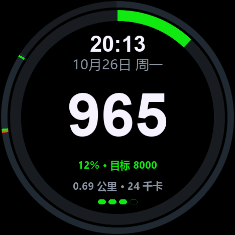
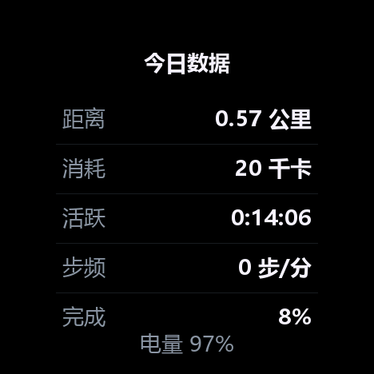
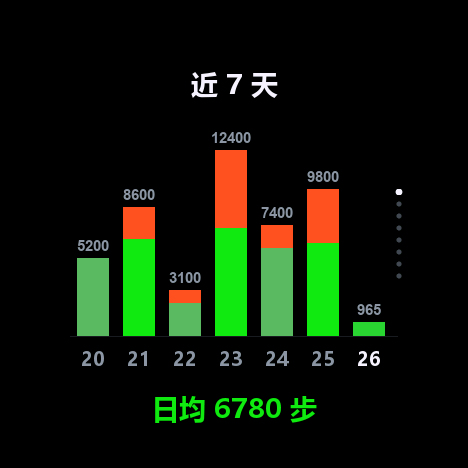
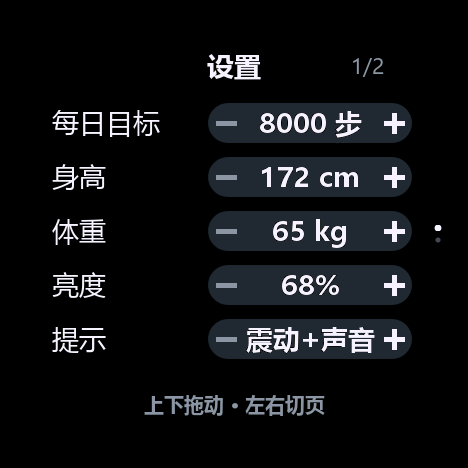
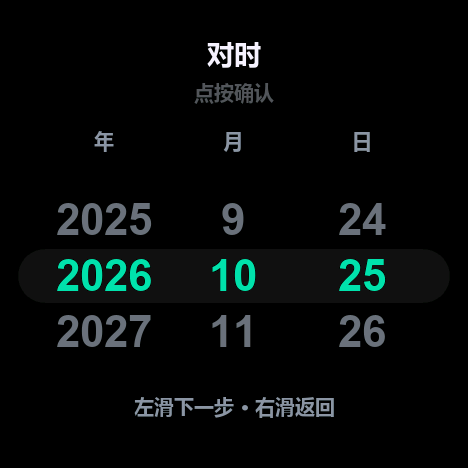

# StopWatch 计步器

M5Stack StopWatch（C152）的计步固件。步数由 BMI270 片上 feature engine 统计，MCU 不读取加速度数据，深睡期间继续计数。



## 硬件

ESP32-S3R8（16 MB Flash / 8 MB OPI PSRAM）、BMI270、466×466 CO5300 AMOLED、CST820 触摸、RX8130 RTC、M5PM1 电源管理、M5IOE1 IO 扩展、450 mAh 电池。

## 功能

- 主页：环形完成度、时间日期、步数、距离与消耗、四段电量指示
- 今日数据：距离、消耗、活跃时长、步频、完成度
- 近 7 天柱状图，当日固定于最右格，未记录的日期留空
- 设置 9 项，列表滚动与手指位移同步
- 对时：日期三列滚轮与 24 小时表盘，结果写入 RX8130
- 息屏、深睡、震动与提示音

## 页面

主页、今日数据、近 7 天、设置四页参与左右循环。对时页由设置中的「对时」项进入。

| 主页 | 今日数据 | 近 7 天 | 设置 |
|---|---|---|---|
|  |  |  |  |

对时页左滑依次切换日期、时、分，点按确认并写入 RTC：



## 操作

屏幕为圆形，四角位于可视区外。界面不设按钮，操作仅通过手势完成。

| 手势 | 作用 |
|---|---|
| 左滑 / 右滑 | 切换页面；对时页进入下一层 / 返回上一层 |
| 点按 | 切换至下一页；设置页修改数值；对时页写入 RTC |
| 上下拖动 | 设置列表与日期轮随手指滚动，松开后吸附至整项 |

| 按键 | 作用 |
|---|---|
| 黄键短按 / 长按 1.2 s | 下一页 / 返回主页 |
| 蓝键短按 / 长按 0.9 s | 息屏 / 当日步数清零 |
| 电源键单击 / 双击 | 唤醒显示屏 / 关机 |

仅按键可唤醒显示屏，触摸不唤醒。

## 设置项

| 项 | 范围 | 步进 | 默认 |
|---|---|---|---|
| 每日目标 | 1000–40000 步 | 500 | 8000 |
| 身高 | 120–220 cm | 1 | 172 |
| 体重 | 30–180 kg | 1 | 65 |
| 亮度 | 40–255 | 15 | 160 |
| 提示 | 静音 / 震动 / 震动+声音 | — | 震动+声音 |
| 息屏 | 5–120 s | 5 | 15 |
| 深睡 | 15–240 s | 15 | 45 |
| 对时 | 进入对时页 | — | — |
| 清零今日 | 连点两次，5 s 内有效 | — | — |

设置存于 NVS 命名空间 `pedo2`，掉电保留。步幅按身高 × 0.415 计算，消耗按 0.53 kcal/(kg·km) 计算。

## 技术实现

| 项目 | 实现 |
|---|---|
| 显示 | M5GFX 驱动 CO5300，QSPI 80 MHz。468×468 RGB565 画布，双缓冲，整屏推送 |
| 触摸 | CST820，I2C 轮询。按下后锁定主轴，纵向滚动列表，横向切换页面 |
| 计步 | BMI270 片上 feature engine 计数，配置包为 legacy（手机场景）。MCU 每秒读取一次计数器，累加差值 |
| 计时 | RX8130 RTC，I2C。每秒读取一次，用于显示与跨天判断 |
| 电源 | M5PM1 三路 LDO，M5IOE1 扩展 IO。显示屏与扬声器位于独立供电轨，可单独断开 |
| 存储 | 设置与当日成绩存于 NVS。修改后 700 ms 写入 |
| 字体 | 点阵字模随固件编译 |

## 休眠与续航

息屏与深睡分两级：无操作 15 s（可调）后亮度归零，再经 45 s（可调）进入 deep sleep。

进入深睡前拉低 M5IOE1 的 IO8，断开显示屏所在的 L3B 轨，AMOLED 停止供电。BMI270 接于常电轨 L1，继续以 100 Hz 采样并计数。深睡期间每 60 s 定时唤醒一次，仅初始化 I2C 并读取计数器，约 25 ms 后继续休眠，显示屏保持关闭。

| 状态 | 电流 |
|---|---|
| 深睡（显示屏断电，BMI270 计数中） | 约 0.26 mA（器件手册估算，未做整机实测） |
| 亮屏正常操作 | 约 45 mA |
| 屏幕全亮 | 约 154 mA |

深睡功耗 0.26 mA 对应每日约 6 mAh。450 mAh 电池全程深睡约 70 天，但每日亮屏时间占主要部分：

| 每日亮屏 | 估算续航 |
|---|---|
| 10 分钟 | 约 30 天 |
| 30 分钟 | 约 15 天 |

接入 USB 时不进入深睡。

## 刷入

发布包下载：[Releases](https://github.com/gpthimble/stopwatch-pedometer/releases/latest)。

完整镜像写入地址为 `0x0`；ESP32-S3 的 bootloader 位于 `0x0`，`0x1000` 为老款 ESP32 的偏移。仅升级 app 时写入 `0x10000`。

```bash
esptool --chip esp32s3 -p COM5 -b 460800 write_flash \
  --flash_mode keep --flash_freq keep --flash_size keep \
  0x0 dist/StopWatch_Pedometer_v2.4.bin
```

三个 `keep` 用于保留镜像 header 中的 flash 模式、频率与容量设定。省略时 header 被改写为 `qio`，ROM 停在 `mode:QIO` 之后反复复位。

进入下载模式：连接 USB，长按电源键约 2 s。网页烧写使用 <https://espressif.github.io/esp-launcher/>，地址 `0x0`、Size `16MB`、Mode `DIO`、Freq `80MHz`。烧写完成后短按电源键重启。

整片擦除将清除设置与步数记录。仅写入 `app_only` 至 `0x10000` 时保留。

## 编译

需要 arduino-cli、esp32 core 3.3.7 与 Python 3。

Windows 下双击 `build.bat`，或执行：

```bash
python tools/build.py
```

脚本获取 M5Unified 0.2.27 与 M5GFX 0.2.34 至 `tools/libs/`，应用 `docs/patches/0001-co5300-wakeup-timing.patch`，编译至 `out/`，输出固件大小与 SHA256。依赖已存在时跳过获取与打补丁。

该补丁修正 CO5300 的唤醒时序（复位释放后等待 120 ms，SLPOUT 居首）；未应用时冷启动出现间歇性黑屏。

手动编译：

```bash
arduino-cli compile \
  --fqbn "esp32:esp32:esp32s3box:PartitionScheme=app3M_fat9M_16MB,DebugLevel=none" \
  --libraries tools/libs --output-dir out StopWatchPedometer
```

板卡为 `esp32s3box`；通用 `esp32s3` 使用 `qio_qspi` 内存类型，OPI PSRAM 无法启动。

编译路径写入镜像，不同目录下的构建产物大小与 SHA256 存在数十字节差异，功能不受影响。

## 串口命令

以 115200 波特率打开串口，发送单字符命令：

| 命令 | 作用 |
|---|---|
| `0`–`5` | 跳转至指定页面，`5` 为芯片诊断页（正常操作不可达） |
| `n` / `p` | 下一页 / 上一页 |
| `c` | 打印计数与 IMU 状态 |
| `S` | 导出单帧 RGB565 |
| `I` | 导出 BMI270 寄存器与 feature 页 |
| `w` | 深睡诊断 |
| `k` | 对照内存设置与 NVS 实际值 |
| `B` | 当日步数清零 |

`tools/devtool.py` 用于抓取屏幕画面：

```bash
python tools/devtool.py seq COM3 "3" page3.png
```

## 已知限制

- 手持晃动与骑行计入步数。
- 无 Wi-Fi 与 BLE，数据仅存于本机。
- 跨天清零依赖 RTC，RTC 未校准时不会自动清零。
- 深睡唤醒需重建 QSPI 面板，自唤醒至可操作约 0.7 s。
- 计步每秒轮询一次，步频较高时显示值每次增加两级，累计数值不受影响。
- 目标默认 8000 步；界面截图中该设置已改为 10000。

## 参考项目

| 项目 | 用途 |
|---|---|
| [boschsensortec/BMI270_SensorAPI](https://github.com/boschsensortec/BMI270_SensorAPI) | BMI270 配置包、feature 页地址、初始化流程 |
| [m5stack/M5Unified](https://github.com/m5stack/M5Unified) | 板级初始化、I2C、电源按键 |
| [m5stack/M5GFX](https://github.com/m5stack/M5GFX)（LovyanGFX） | 显示驱动与绘图，应用唤醒时序补丁 |
| [m5stack/M5StopWatch-UserDemo](https://github.com/m5stack/M5StopWatch-UserDemo) | M5PM1 / M5IOE1 / CO5300 的寄存器用法参考 |
| [m5stack/M5StopWatch-PowerDemo](https://github.com/m5stack/M5StopWatch-PowerDemo) | 电源分轨与深睡实测数据 |
| [espressif/arduino-esp32](https://github.com/espressif/arduino-esp32) | 3.3.7 核心 |
| [espressif/esptool](https://github.com/espressif/esptool) | 烧写与镜像合并 |

## 关于 AI 参与

本项目的固件代码、调试脚本与文档由 AI（WorkBuddy）编写，硬件实测、现象反馈与验收由项目作者完成。寄存器取值、配置包来源与页地址均对照上游源码与 Bosch 文档核对，关键结论在代码注释中标注出处。
